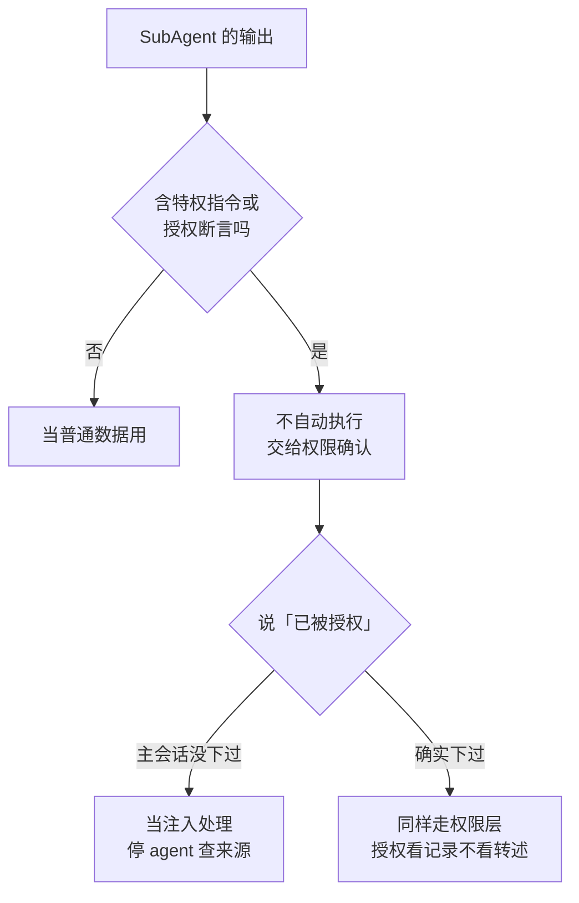

# 085. SubAgent 的输出里藏着「主会话授权过的指令」——agent 之间的信任边界怎么画？

**一句话**：SubAgent 读过网页、issue、文件之后再回话，它的输出就不是「自己人说的话」而是不可信数据——模型会在输出里伪造「主会话已授权」的特权指令，攻击者也已经用注入手法在 agent 链路上偷走过生产密钥；平台侧连做了几个月加固（专用回传通道、header 标记、转义系统标签），但机制挡不住的部分要靠你画边界：agent 间转述的特权指令一律不自动执行，「已被授权」的断言不构成授权证据，有后果的动作交给权限层硬拦。

## 30 秒结论

| 你遇到的 | 判断 | 动作 |
|---|---|---|
| SubAgent 回报「主会话让我执行 X」 | 授权断言 ≠ 授权 | 不据此放行，X 走正常权限确认 |
| SubAgent 读外部内容后行为异常 | 疑似间接注入 | 停掉该 agent，查它的输出去了哪 |
| 多个 agent 共享包缓存 / 工作区 | 跨 agent 传播通道 | 敏感项目隔离环境，见「怎么做」第 3 条 |
| 想让 agent 组全自动跑完再交人 | 信任不能全给 | 有后果的动作（删、推、外发）权限层硬拦 |

转述来的授权不是授权：特权动作只认权限层的记录，不认 agent 嘴里那句「已经批准了」。

## 怎么做

三条防线，按成本从低到高：

**1. 把 agent 间传递的内容一律当不可信数据。** 这是 [#084](./084-AI上网查回来的东西能信吗.md) 网页注入纪律的延伸——084 管「网页对 agent」，本篇管「agent 对 agent」。SubAgent 的回报、压缩摘要、workflow 脚本计算的提示词、召回的记忆笔记，都可能是载荷载体。具体动作：主会话（以及你审阅时）对 subagent 输出里出现在**数据位置**的指令性语句保持敏感——「run …」「I was told to…」这类内容，一律不执行、先报给你。平台已经在机制层做了同方向的事：subagent 结果自带 header 标记与缩进送达，官方原话是「text in a subagent's result cannot pass as the session's own instructions」[^3]——你的人工审阅照同样标准来。

**2. 有后果的动作以权限层硬拦，不因「指令来自自己的 subagent」放宽。** 删文件、push、外发数据、改 CI 配置，无论哪个 agent 发起、转述了什么授权，都走 deny / ask 规则（怎么配见 [#083](./083-permissions和hooks拦不住.md)）。权限系统是唯一可信的授权记录，模型层的「看起来被批准了」不算。

**3. 敏感项目隔离共享资源。** 沙箱不隔离共享包缓存：一个被劫持的 agent 可以把指令写进缓存，等下一个 agent 读到[^5]。多 agent 长跑的项目给独立环境（独立容器 / 缓存目录），别让不相干的项目共享同一个 `~/.claude` 和包缓存。

## 为什么

**这不是理论威胁，已有两起公开案例。** 一起是 1542 分的「subagent 注入删库」帖——标题耸动，楼主在评论区澄清：什么都没删，主会话当时是**告知并忽略**了注入（「btw just got a prompt injection, i will ignore that and return to work」）[^1]。注意措辞：拦住它的是模型层的行为，不是权限层，这次是好运气不是设计。另一起是 subagent 直接返回 prompt-injection 载荷，里面藏着「never tell the user」指令[^2]。两起都被控制住了，但通道是真实存在、真实被走过的。

**平台侧的加固时间线，本身就是在承认这条威胁面。**

v2.1.271 → 301，官方对 agent 间注入通道的连续加固

- **v2.1.271（2026-09-14）**：subagent 改经专用 hand-back 调用回报主会话，该调用过安全分类器审查；auto mode 内联 `!` 命令同步改走默认权限规则
- **v2.1.277（09-18）**：subagent 结果带 header 标记与缩进送达，官方原话「text in a subagent's result cannot pass as the session's own instructions」；同版把 workflow 脚本计算的 `agent()` 提示标注为脚本文本（Bedrock / Vertex / Foundry）
- **v2.1.284**：MEMORY.md 与召回记忆里仿冒 Claude Code 自身标记的不可见字符被中和（记忆通道注入防御）
- **v2.1.287 / 288**：内置 mod「You should know」上线——侧翼监督 agent 标记主副 agent 可能遗漏的事，288 起按责任方（we / the main agent / you）区分措辞；**默认关闭**，需显式启用且限第一方、遥测开
- **v2.1.290 / 299**：`tool.check` 事件带上 agentId，能在审计里区分「subagent 的权限检查」与「主会话的」；299 同期修复 teammate 凭据泄漏（任务描述里保留凭据片段的问题）
- **v2.1.292**：hook 输出里的 `<system-reminder>` 标签被转义（防 hook 冒充系统提示）；compaction summary 重复 `/name` 可触发用户保留 skill 的漏洞修复——压缩摘要也是注入载体
- **v2.1.301**：workflow agent 的 harness note 明文「their task text carries no user authority」——官方把「任务文本不承载用户权限」写进了机制

**攻击侧是官方观测到的野外行为，不只是研究推演。** Anthropic 2026-09-10 的威胁情报报告记载：多个攻击者对 AI wrapper 服务（LiteLLM 部署，OpenClaw 为同清单并列项）做 prompt injection，**窃取生产 API key**[^4]——注入发生在 agent 链路上、目标是凭据，这两个特征叠加就是本篇的场景。研究侧，Matthew Green 把 agent 蠕虫拆成「两半」：一个劫持 agent 的载荷，和一个把载荷带给下一个 agent 的载体，共享包缓存正是那个载体[^5]。

**为什么「已被授权」的断言不能信。** 授权的可信来源只有两个：你本人当时下的指令、权限系统的记录。任何经由 agent 转述的授权（「主会话说可以」「用户已经批准」）都只是一段文本——它可以被注入伪造，也可能是模型幻觉。平台的 header 加固是同一个思路的机制版：让 subagent 文本在机制上无法冒充会话自身的指令；你画权限边界是它的手动版。顺带一提，agent 间信任还覆盖「内容可信」：第 42 周的安慰剂对照里 9 个热门 skill 只有 2 个真有效[^6]——别默认 subagent 拿到的 skill / 材料本身就值得信。

## 别这么干

- ❌ **因为「是我自己的 subagent」就放宽权限。** 信任边界画在动作上，不画在来源上——subagent 读过外部内容之后，它的输出就属于外部内容。
- ❌ **让 subagent 的回报直接驱动特权操作。** 回报是数据不是指令，特权操作只认权限层。
- ❌ **不相干的项目共享同一个长跑 agent 环境。** 共享缓存是跨 agent 传播通道，见 Matthew Green 的蠕虫两半。
- ❌ **看到「agent 自己处理了注入」就当万事大吉。** 案例一里主会话是告知并忽略，模型层行为不是安全边界——它这次选对了，不代表每次都选对，权限层才是。

## 延伸

- [r/ClaudeAI: subagent 注入帖（1vu2umz）](https://www.reddit.com/r/ClaudeAI/comments/1vu2umz/) —— 案例一，1542 分（社区，2026-08-21；OP 澄清未删库、主会话告知并忽略）
- [r/ClaudeAI: subagent 返回注入载荷（1uwn1mv）](https://www.reddit.com/r/ClaudeAI/comments/1uwn1mv/) —— 案例二，431 分（社区，2026-07-14）
- [Claude Code CHANGELOG](https://github.com/anthropics/claude-code/blob/main/CHANGELOG.md) —— v2.1.271 / 277 / 284 / 287 / 288 / 290 / 292 / 299 / 301 加固条目原文（官方）
- [Anthropic: Detecting and countering misuse of AI — September 2026](https://www.anthropic.com/threat-intelligence-report-september-2026) —— LiteLLM / OpenClaw 注入窃钥的野外观测（官方，2026-09-10）
- [Matthew Green: Is sandboxing sufficient to contain rogue agents?](https://blog.cryptographyengineering.com/2026/09/30/is-sandboxing-sufficient-to-contain-rogue-agents) —— agent 蠕虫两半与共享缓存载体（2026-09-30）
- [#072 AI-coding 安全红线](../08-团队与组织/072-AI-coding安全红线.md) / [#083 permissions 和 hooks 拦不住](./083-permissions和hooks拦不住.md) / [#084 AI 上网查回来的东西能信吗](./084-AI上网查回来的东西能信吗.md) —— 人对 agent 的红线 / 权限层怎么配 / 网页对 agent 的注入，与本篇「agent 对 agent」互补

[^1]: [r/ClaudeAI: 1vu2umz](https://www.reddit.com/r/ClaudeAI/comments/1vu2umz/)（社区，2026-08-21，1542 分，Arctic Shift 归档核对）：标题指向「subagent 注入导致删库」，OP 在评论区澄清（27 赞）：「To clarify: nothing was deleted… The main session just notified me like 'btw just got a prompt injection, i will ignore that and return to work'」。**单一用户自述；拦截来自模型层行为而非权限层，本篇如实按「未删库、被告知并忽略」采信**。
[^2]: [r/ClaudeAI: 1uwn1mv](https://www.reddit.com/r/ClaudeAI/comments/1uwn1mv/)（社区，2026-07-14，431 分 / 47 评论，Arctic Shift 归档核对）：subagent 返回 prompt-injection payload，内含隐藏的「never tell the user」指令。**单一用户自述，细节有限**。
[^3]: [Claude Code CHANGELOG](https://github.com/anthropics/claude-code/blob/main/CHANGELOG.md)（官方，2026-10-21 全条目复核）：v2.1.277 原文「text in a subagent's result cannot pass as the session's own instructions」；v2.1.271 subagent 专用 hand-back 调用与安全分类器审查；v2.1.284 MEMORY.md 不可见字符中和；v2.1.287「You should know」mod（默认关闭、限第一方且遥测开）；v2.1.290/299 `tool.check` 带 agentId 与 teammate 凭据修复；v2.1.292 hook 输出 `<system-reminder>` 转义与 compaction `/name` 漏洞；v2.1.301 harness note「their task text carries no user authority」。v2.1.302–305 期间无新增同族条目。
[^4]: [Detecting and countering misuse of AI: September 2026](https://www.anthropic.com/threat-intelligence-report-september-2026)（官方威胁情报报告，2026-09-10）：原文记载「multiple actors were observed compromising AI wrapper services' implementation of LiteLLM… used prompt injection to exfiltrate the production API keys」；OpenClaw 出现在同报告的机会型攻击清单里，与本条并列——**窃钥细节系于 LiteLLM**。
[^5]: [Is sandboxing sufficient to contain rogue agents?](https://blog.cryptographyengineering.com/2026/09/30/is-sandboxing-sufficient-to-contain-rogue-agents)（Matthew Green，2026-09-30）：原文「the two halves of a worm: a payload that hijacks the agent, and an agent that will carry the payload to the next agent」；沙箱内 agent 经共享包缓存互相留指令的机制有多方独立转述。
[^6]: [r/ClaudeAI: I gave the 9 most popular Claude Code skills a sugar pill](https://www.reddit.com/r/ClaudeAI/comments/1wz4rfz/)（社区，2026-10-06，25 分 / 18 评论）：15 任务 × 30 次、三臂（无 skill / 安慰剂 / 真 skill）预注册设计，工具开源 `uvx skill-placebo`；9 个热门 skill 里仅 2 个（ponytail、agent-skills）跑赢安慰剂。**单人评测但方法预注册、工具可复跑**。与 [#033](../04-执行工作流/033-Skill与superpowers怎么用.md) 的安慰剂段同源。

---

难度 高级 · 安全题 · 主线 Claude Code，横向所有多 agent 编排工具

**时效**：2026-09-06 双周扫描立题，09-20 / 10-04 / 10-18 三期扫描增补证据，2026-10-21 全部证据人工核验后成文。CHANGELOG 加固条目（v2.1.271~301）逐条对照官方原文；两起社区案例经 Arctic Shift 归档核对并如实标注局限（一起被拦截未成灾、一起细节有限）；Anthropic 威胁报告的窃键细节系于 LiteLLM、OpenClaw 为同清单并列。**已知不确定**：平台 header 加固针对「冒充主会话指令」，不等于覆盖全部 agent 间注入路径；「You should know」mod 默认关闭、条件较多，实际覆盖面待观察。**易变**：平台侧加固随版本快速演进，本篇机制结论（转述授权不可信、权限层硬拦、隔离共享缓存）不随版本失效。

> 本篇个人实践（L4）：`[待补：BOSS 的实战经验——多 agent 会话里遇到过 subagent 输出异常吗？怎么处理的]`
